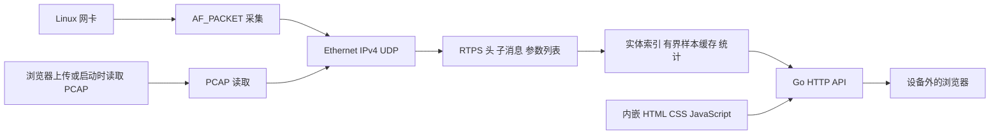

# ProtoWatch 技术方案

版本：0.1  
日期：2026 年 10 月 19 日  
部署目标：Linux ARM64，单个可执行文件，通过浏览器访问

采用 **Go 后端、Linux 原生抓包、Vue 3 网页与静态资源内嵌**。一个进程同时完成采集、RTPS 解析、内存聚合和 HTTP 服务，前端资源编译进可执行文件。设备不需要安装 Go、Node.js、Python、DDS SDK、数据库或 libpcap；运行数据和可选 TLS 证书属于用户数据，不属于额外服务依赖。

先交付 MVP0，验证“ARM64 设备启动 → 浏览器访问 → 发现实体 → 查看实际样本”的完整流程。复杂解码和诊断留到后续，不将产品文档中的全部完整首版目标一次性纳入 MVP。

## 1 技术栈选择

| 部分 | 当前选择 | 选择原因 |
| --- | --- | --- |
| 后端 | Go，模块版本与依赖在 go.mod / go.sum 固定 | HTTP、并发、二进制协议处理与 ARM64 交叉编译适合放在同一工程 |
| 实时采集 | gopacket 的 pcapgo.EthernetHandle，Linux AF_PACKET | 使用 Go 和系统调用；避免 CGo 与 libpcap 运行时依赖 |
| 网络层解析 | gopacket layers | 复用 Ethernet、VLAN、IPv4、UDP 解析，减少基础网络协议代码 |
| DDS 观察 | 自有受限 RTPS 解析器 | 只解析已捕获报文，不实现完整 DDS 中间件，不创建参与者 |
| 网页 | Vue 3、TypeScript、Vite、Element Plus | 单文件组件维护表格和详情交互，静态构建产物内嵌，无额外运行时服务 |
| 静态资源 | Go embed.FS | 网页随程序发布，运行时不读取外部前端目录，不依赖 CDN |
| 服务接口 | 标准库 net/http，JSON REST，1 秒轮询 | 单向观察量小，先避免长连接重连及增量同步状态机 |
| 数据保存 | 有界内存，手动导出 JSON | MVP 不引入数据库；重启不恢复现场，导出明确保留范围 |
| 发布 | CGO_ENABLED=0，GOOS=linux，GOARCH=arm64 | 生成适用于 Linux ARM64 的单个程序，检查产物是否存在动态依赖 |

`pcapgo` 提供原生 Go 的 PCAP 读取和 Linux 抓包接口；本项目使用维护中的 `github.com/gopacket/gopacket` 模块，并且不导入依赖 libpcap 的 `pcap` 包。[pcapgo 文档](https://pkg.go.dev/github.com/gopacket/gopacket/pcapgo)

Go 支持将文件编译进程序并通过 `http.FileServer` 提供，适合这里的单二进制网页部署。[Go embed 文档](https://pkg.go.dev/embed)

### 1.1 备选方案比较

| 方案 | 优势 | 本项目取舍 |
| --- | --- | --- |
| Go 加内嵌网页 | 部署简单，HTTP 和并发实现直接，跨架构构建成本较低 | 本次采用；动态 DDS 类型能力需要额外实现或适配 |
| Rust 加 Axum 与静态资源 | 适合底层解析和明确的内存控制，有原生 Rust DDS 项目 | 可行，但当前被动 MVP 不需要引入完整 DDS 栈，收益不足以改变选择 |
| C++ 加 Fast DDS 或 Cyclone DDS | 适合主动参与、订阅与厂商类型接口 | 可静态打包，但依赖、交叉工具链和可选功能配置成本更高；主动模式再评估 |
| Python 加 Web 服务 | 原型开发方便 | 与只部署一个原生可执行文件的目标不如 Go 直接契合 |
| tshark 子进程加网页 | 复用大量协议解析能力 | 需要外部程序及对应依赖，不满足当前交付约束 |

Rust 与 C++ 都不是因为不能生成单文件而排除；选择基于当前以被动观察为主的范围。未来若核心需求变成自动订阅、完整 XTypes 或 DDS Security，应重新评估使用成熟 DDS SDK 的成本。[Dust DDS](https://docs.rs/dust_dds/latest/dust_dds/)、[Fast DDS 项目](https://github.com/eProsima/Fast-DDS)

## 2 MVP 与完整首版的边界

| 能力 | 当前 MVP0 | 后续完整首版 |
| --- | --- | --- |
| Linux ARM64 单文件与网页 | 实现，目标设备需现场验证 | 持续保持 |
| 实时抓包 | 单个启用的 Ethernet 兼容接口，AF_PACKET | 进一步优化和验证接口类型 |
| 离线输入 | 未压缩 classic PCAP，网页上传默认最多 4 GiB（`--max-import-mib` 可调整），本地 `--read` 不限总大小，Ethernet / Linux SLL | PCAPNG、多接口文件、证据包 |
| 发现 | SPDP / SEDP 的 GUID、名称、类型及部分 QoS | 更完整的参数、生命周期和兼容性分析 |
| 用户样本 | 未分片 DATA，原始载荷与编码标识 | DATA_FRAG 与 IP 分片重组 |
| 类型解码 | 不解析业务字段，保留十六进制和 Base64 | IDL 导入、受限 XCDR1 字段解码，再扩展 XTypes |
| 统计 | 样本、载荷大小、5 秒窗口速率、有限窗口去重 | 更完整诊断和统计，增加性能优化 |
| 数据导出 | 实体快照、保留样本和提示的 JSON | 原始录制、可复查证据包 |
| ROS 2 | 复用 DDS，提示可能的 rt/ 名称映射 | 专用语义按需求增加，不影响主线 |

**重要区分**：能看到 Topic、类型名和样本字节，已经能确认观察点有哪些数据在传输；尚不能解释任意业务字段的含义。MVP 网页始终标注“原始载荷”，不把十六进制展示称为完成 IDL 解码。

不支持的分片、安全子消息和编码给出状态或计数。没有捕获到流量时仍受镜像口、网卡选择、共享内存和发现路径等可见性约束，详见产品文档第 3 节。

## 3 运行架构



进程同一时刻维护一个观察会话。开始新采集或成功验证新文件头后导入文件会替换当前结果；运行中的会话必须先停止。正在运行的会话不能被另一次导入覆盖。

实时与离线输入共享网络解析器和 RTPS 解析器。离线统计以文件内最后观察时间为基准，文件读取结束显示“离线分析完成”，不推断所有参与者退出。

### 3.1 代码结构

```text
cmd/proto-watch/          命令行、HTTP 生命周期、启动读取与采集
internal/capture/      Linux 采集、其他系统占位实现、PCAP 输入
internal/rtps/         RTPS 报文与发现参数解析
internal/watch/        实体、Topic、样本缓存和统计
internal/server/       API、访问控制、会话管理
internal/server/web/   内嵌网页和明确标记的合成示例
tools/generate_demo.py 仅开发期使用的示例生成器
docs/                  产品与技术方案
```

Go build tags 隔离 Linux 实时采集实现。在 macOS 上可以开发网页、读取 PCAP 和运行解析测试；这不等价于 macOS 支持实时抓包。

## 4 采集和协议处理

### 4.1 抓包方式与权限

实时采集使用 AF_PACKET 原始套接字，绑定用户选择的接口，读取包与内核时间戳。套接字设置独立的混杂模式成员关系，关闭后释放；混杂模式本身不能使交换机转发本来不可见的单播流量。

创建 packet socket 需要当前网络命名空间中的 `CAP_NET_RAW`。普通非特权进程仍可使用 PCAP 导入。[Linux packet socket 手册](https://man7.org/linux/man-pages/man7/packet.7.html)

当前版本不实现任意 BPF 表达式编译，也不创建监听 DDS 端口的 Participant。采集流量进入用户态后筛选 RTPS；高背景流量可能增加开销。若 ARM64 实测有瓶颈，优先增加经过验证的内核过滤，然后评估 AF_PACKET mmap 环形缓冲，而不是先改写应用层协议。

### 4.2 解析规则

1. 从 Ethernet 或 Linux SLL 进入 IPv4 / UDP，不按固定 DDS 端口识别协议。
2. 根据 UDP 载荷的 RTPS 标识和版本解析协议头。
3. 根据各子消息自身的大小端与长度读取 DATA、INFO_SRC 等，未知消息按长度跳过。
4. DATA 的 inline QoS 与 serialized payload 独立处理，不能固定把整个 DATA 尾部当作业务数据。
5. 识别内置发现 Writer，解析 PL_CDR 参数列表，提取 Participant 与 Endpoint GUID、Topic、类型名、显式 Domain 及 Reliability / Durability。
6. 普通 Writer 的未分片样本进入统计和缓存，Key-only 与内置流量不混入普通业务样本。

序列号使用有符号高 32 位与低 32 位组合，在 API 中以字符串返回，避免浏览器整数精度问题。GUID 使用完整十六进制字符串，IP 地址不是实体身份。

参考 RTPS 参数编号时使用标准对应实现定义，解析器仍按受限能力逐项验证；发现接口不等于完整 DDS API。[Fast DDS ParameterTypes](https://github.com/eProsima/Fast-DDS/blob/master/include/fastdds/dds/core/policy/ParameterTypes.hpp)

### 4.3 实体和 Topic 归属

样本先关联 Writer GUID，再通过 SEDP 获得 Topic 和类型。先收到数据后收到公告时，现有样本在查询时补充名称；没有公告时展示未知 Topic。

Topic 按显式 Domain、名称和类型名聚合。Domain 未知时按参与者隔离，防止把不同未知域的同名 Topic 合并。该聚合只用于观察列表；尚未验证类型结构和完整 QoS，不构成端点匹配结论。Partition 暂不进入兼容性推断。

MVP 保留会话中观察过的实体和最后出现时间，不实现完整租约状态机。明确区分从 RTPS 头推断的参与者与实际看到 SPDP 公告的参与者。

### 4.4 统计和资源控制

| 资源或指标 | MVP 规则 |
| --- | --- |
| 样本缓存 | 全会话最近 256 条，淘汰最早插入的记录 |
| 单样本预览 | 最多 16 KiB；原载荷长度保留，截断明确标记 |
| 去重 | 最近 65,536 个 Writer GUID 与序列号组合；窗口外重复可能再次计数 |
| 参与者和端点 | 最多 1,024 个参与者、4,096 个端点，拒收新增对象时计数提示 |
| 字符串和参数 | 单个 CDR 字符串最多 4,096 字节，每个参数列表最多 1,024 项 |
| PCAP 文件 | 网页上传默认最多 4 GiB（`--max-import-mib` 可调整），本地 `--read` 不限总大小，单条捕获最大受 1 MiB snaplen 限制，拒绝压缩输入 |
| 文件上传 | 同时最多一个上传读取；导入支持请求取消 |
| 频率 | 5 个一秒桶，统计最近 5 秒完整 DATA 样本；离线以捕获时间计算 |
| 内核丢弃 | 定期读取并累加内核计数，结束关闭附近可能存在未读尾部计数 |

网页轮询只获取元信息，打开样本才获取载荷。完整 JSON 导出包含有限缓存的载荷；不是 PCAP，也不能据此复原已经淘汰的数据。

## 5 网页与接口

网页包括 Topic 总览、参与者、读写端点、观察提示和样本详情。支持名称筛选、按 Topic 查看样本、暂停界面刷新、停止采集、PCAP 上传和 JSON 导出。

| 方法与路径 | 功能 |
| --- | --- |
| GET /api/interfaces | 网卡列表、实时采集支持状态、版本 |
| GET /api/state | 当前会话、实体、统计、样本元信息和提示 |
| POST /api/capture/start | 选择接口开始采集；JSON 字段 interface |
| POST /api/capture/stop | 停止当前采集或导入 |
| POST /api/import?name=... | 请求体为原始 PCAP 文件内容，替换会话 |
| GET /api/samples/{id} | 样本元信息、十六进制和 Base64 预览 |
| GET /api/export | 导出当前内存快照与保留样本 |

### 5.1 前端实现

使用 Vue 3 Composition API 与 `<script setup lang="ts">`，遵循 Vue 官方推荐的单文件组件和 Vite 工作流。[Vue 快速开始](https://vuejs.org/guide/quick-start.html)

- `App.vue` 负责页面会话、导航和组件组合。
- `ObservationTable` 展示 Topic、参与者、端点和观察提示；`SampleTable` 按 Topic 键筛选样本；`SampleDialog` 用 Descriptions 与 Dialog 展示元信息和原始字节，可切换十六进制与 Base64。
- `createWatchClient` 统一处理上传、控制请求和轮询。轮询不重叠；会话变更使旧请求失效；组件卸载时取消请求与定时器。
- API 数据使用 TypeScript 接口描述；文本使用 Vue 插值，构建产物不依赖运行时模板编译和 CDN，兼容现有 CSP。
- 开发环境由 Vite 提供热更新和 API 代理，保留 Host 与 Origin，兼容后端同源校验。生产环境仅由 Go 提供静态页面和 API。
- 界面采用 Element Plus，按组件具名导入并使用中文语言包。提供表格排序、样本分页、网卡搜索、可关闭筛选标签和载荷详情弹窗；配色与布局使用统一工作台样式。单页 MVP 暂不引入 Vue Router 或 Pinia。[Element Plus 文档](https://element-plus.org/en-US/guide/quickstart.html)

首版轮询间隔 1 秒。未来若实体数量和浏览器数量增加，先增加分页与按需查询，再评估 SSE。无需一开始引入 WebSocket、消息队列或时序数据库。

## 6 单二进制构建和部署

### 6.1 构建

开发机安装与 go.mod 兼容的 Go，以及 Node.js（20.19+ 的 20.x，或 22.12+）后执行：

```sh
make arm64
```

构建顺序为 `npm ci` → `vue-tsc` → `vite build` → Go 编译。前端输出目录为 `internal/server/web/`。如网页资源已经构建，Go 编译命令为：

```sh
CGO_ENABLED=0 GOOS=linux GOARCH=arm64 go build \
  -trimpath -ldflags="-s -w" \
  -o bin/proto-watch-linux-arm64 ./cmd/proto-watch
```

复制生成的程序到设备即可；不会在设备上运行前端构建。Node.js 仅用于开发和构建，Python 仅用于重新生成开发示例。依赖版本固定在 go.mod、go.sum 和 frontend/package-lock.json，发布时记录 Go 版本与构建产物摘要。[Go 构建目标与环境变量](https://go.dev/doc/install/source#environment)

交付验收应检查 ELF 架构为 AArch64，并确认没有 `PT_INTERP` 和 `DT_NEEDED`。静态程序仍依赖 Linux 内核及 AF_PACKET 功能；不能将 Linux ARM64 程序用于 Android、macOS 或 32 位 ARM。

### 6.2 设备启动

以下命令在目标 Linux 设备执行，接口名使用设备实际值：

```sh
chmod +x ./proto-watch-linux-arm64
sudo setcap cap_net_raw=ep ./proto-watch-linux-arm64
./proto-watch-linux-arm64 --interface eth0
```

默认网页监听 `127.0.0.1:8080`。通过 SSH 转发可以从开发机访问设备上的页面，设备仅部署这一个应用程序：

```sh
ssh -L 8080:127.0.0.1:8080 user@device-ip
```

开发机浏览器打开 `http://127.0.0.1:8080`。设备已有 SSH 服务时不需要为本工具增加反向代理。

需要直接从局域网访问时，显式监听外部地址：

```sh
./proto-watch-linux-arm64 --listen 0.0.0.0:8080 --interface eth0
```

浏览器直接访问设备地址，无需令牌或登录。普通 HTTP 不加密；跨不可信网络使用 SSH 转发，或用 `--tls-cert` 和 `--tls-key` 开启程序内置 HTTPS。

启动时直接载入文件：

```sh
./proto-watch-linux-arm64 --read capture.pcap
```

`setcap` 可能依赖设备已有的系统管理工具和文件系统 capability 支持；受限容器还需允许相应网络权限。设备无法授予抓包能力时，离线文件分析仍可用。替换程序文件后需重新检查 capability。

### 6.3 访问和运行边界

不设访问令牌，能够访问监听地址的使用者可直接调用 API。API 不开放跨域访问，请求带有 Origin 时校验其与 Host、协议一致。页面用文本转义展示来自网络的名称，避免把 DDS 数据解释成脚本。

MVP 不提供多租户和细粒度权限，能够访问服务的使用者可以启动或停止该观察会话、导入文件和查看载荷。关闭程序会丢失内存结果，需要保留时先导出。

## 7 测试与验证

| 层次 | 验证内容 |
| --- | --- |
| 协议单元测试 | 大小端、64 位序列号、inline QoS、越界长度、分片和安全子消息标记 |
| 解析健壮性 | Go fuzz 对随机和截断 RTPS 输入检查崩溃及越界 |
| 数据模型 | 样本去重、有界缓存、预览截断、乱序时间桶和 Domain 隔离 |
| 文件输入 | 合成网络发现与样本计数、恶意长度、不支持封装、取消 |
| HTTP 集成 | 导入、样本详情、导出、内嵌网页、无凭据本地 / 局域网访问与跨域保护 |
| 并发 | Go race 检查，后续补充目标设备实时采集压力测试 |
| 发布 | 无 CGo 的 Linux ARM64 交叉编译和 ELF 动态依赖检查 |
| 网页 | 实际浏览器检查示例导入、列表切换和样本详情 |

仓库示例由本地脚本合成，共 128 个包、2 个参与者、6 个端点、3 个 Topic 和 120 条用户样本。它用于可重复的功能检查，不能代替 Fast DDS、Cyclone DDS 或 ROS 2 的真实兼容性验证。

开发机不具备运行目标 Linux 抓包环境的条件时，仅报告已完成的编译、文件分析和浏览器验证，不报告目标设备实测通过。

## 8 下一阶段

1. 在用户实际 ARM64 设备用已知发布订阅程序验证权限、网卡、发现信息和统计；记录内核、CPU、内存、DDS 版本和配置。
2. 收集 Fast DDS 与 Cyclone DDS 的真实 PCAP，建立能分辨工具错误与网络不可见性的回归样例。
3. 实现 DATA_FRAG 与 IPv4 分片的有界重组，解决大样本可见性。
4. 实现 IDL 导入和受限 XCDR1 解码，使用已知字段值验证，避免只凭类型名推断结构。
5. 按现场需要补充 PCAPNG、录制、租约生命周期、QoS 诊断与主动模式。

ROS 2 仍作为可选兼容目标：采用受支持 DDS / UDP 路径时复用现有观察能力；名字推测、节点语义和任意消息解码不影响本阶段交付。


## 9 SOME/IP 扩展（0.2 MVP，已实现）

SOME/IP 扩展已实现，完整设计与交付清单见 [SOMEIP.md](SOMEIP.md)。本节是对前文 DDS MVP 范围的增量说明。

采集器通过 Sink 接口提交帧；`internal/packet` 解析网络外层，`internal/watch/ingest.go` 负责会话计数和协议分发，DDS 聚合迁移到 `dds.go`。`internal/someip` 独立处理 TCP 流重组、UDP 多消息、服务发现、TTL、端点实例关联和有界消息缓存。保留原 DDS API，快照增加 `someip` 对象。

前端增加 DDS / SOME/IP 切换，复用采集入口、快照导出、Element Plus 组件和样式。SOME/IP 页面提供服务实例、方法 / 事件、发现记录、诊断与消息详情；名称和端口配置支持网页导入及 `--someip-map` 启动参数。配置可选，不影响单二进制运行。

SOME/IP 不使用 DDS 的 Writer / Sequence 去重规则。没有有效 SD 实例关联时保留未知；报文头匹配的自动识别明确标为推测。TCP 流重组已实现；TP 重组、ARXML / FIDL 解码和主动调用属于后续范围。


## 10. 大文件流式导入增量

网页上传默认 4 GiB，启动参数 `--max-import-mib` 可调整；`/api/interfaces.max_import_bytes` 向网页公布当前上限，前后端共同校验。启动时 `--read` 直接读取文件流，不设总大小限制。

PCAP 全局头仅预读 24 字节，再用 `pcapgo.Reader.ZeroCopyReadPacketData` 复用单包缓冲，存储层复制需要保留的样本内容。HTTP 通过 `MaxBytesReader` 限制输入，不使用整文件 `ReadAll` 或磁盘中转；单包 snaplen 仍限 1 MiB。`/api/state.import_bytes` 和 `import_total` 提供已读取字节与已知总大小，包数表示已完成解析的记录。进度统计可能包含解析器预读的少量数据，不等同完整协议解码进度。

上传期间继续轮询状态；取消上传会中断请求，并保留部分观察结果。后台停止接口可中断正在等待读取的导入。仅上传接口取消总请求读写时限，使用每次读前更新的 2 分钟空闲读取期限；取消时将读取期限设置到当前时刻以解除阻塞。只有正常 EOF 才标记完成，截断和超限保留错误状态。无效文件头或已知超限在重置会话前拒绝；开始解析后出现错误则当前会话是部分结果。


## 11. 服务端离线目录与后台任务

新增 `--pcap-dir`（默认启动工作目录）、`GET /api/files` 与 `POST /api/files/open`。列表返回目录、文件名、大小、修改时间和截断标识；加载请求只提交文件名，立即返回 202，数据由服务端磁盘直接读取，无总文件大小限制。

目录以 `os.Root` 约束访问，API 只接受目录内 `.pcap` / `.cap` 普通文件名称，不接受相对穿越、绝对路径、子目录或符号链接。目录列表扫描和返回数量有界。无效头部在替换原会话前拒绝；后续读取错误显示部分结果与错误状态。

后台任务在返回 202 前预留会话并标为 importing，持有文件句柄和独立取消上下文，刷新网页不会取消任务。复用原有状态进度及停止接口，停止时取消上下文并关闭句柄；完成或失败均释放文件。CLI `--read` 也采用此后台任务，使 HTTP 服务及时可用。实体缓存和单包大小上限保持不变。


## SOME/IP TCP 增量

`packet.Decode` 保留 TCP 序列号及 SYN / ACK / FIN / RST 标志，`someip/tcp.go` 按四元组、方向和 SYN 跟踪连接。连续字节按 SOME/IP Length + 8 拆帧，支持跨包、粘包、有限乱序和重传去重。采集入口保持共用，实时和离线使用同一条解析路径。

每消息 4 MiB、256 个连接、全局 32 MiB 缓存内容，每方向 128 个乱序段 / 256 KiB 前向窗口；空闲 60 秒清理。缺口不跨越，未知边界不猜测，错误及超限停止该方向；结束会话清空残缺缓存并保留提示。TCP / UDP 实例关联按对应 SD 端点匹配，详情和导出均带传输方式。完整语义与限制见 [SOME/IP 文档](SOMEIP.md#tcp-重组语义)。


## GitHub Release 自更新

`internal/update` 负责固定仓库 `bkcarlos/ProtoWatch` 的稳定版本检查、平台包选择、下载、校验、备份和替换。服务端只接受已检查且高于当前版本的标签，不接受客户端传入下载 URL 或路径。版本按三段数字比较；同一基础版本的稳定发布高于带开发后缀的构建，不执行降级。

接口：`GET /api/update` 查询当前版本、平台和状态；`POST /api/update/check` 检查最新稳定 Release；`POST /api/update/install` 提交 `{ "version": "vX.Y.Z" }` 后返回 202。安装在后台执行，互斥拒绝重复操作；原有同源请求检查同样适用。状态包含 idle/checking/downloading/installing/restarting/error，网页轮询状态并在版本改变后提示刷新。

HTTPS 下载只允许 GitHub API、GitHub 与官方 Release 资源域名，安装包及独立校验文件必须来自固定仓库的对应标签。元数据限制 2 MiB、校验文件 4 KiB、压缩包 128 MiB、二进制 256 MiB。只提取预期路径下的普通可执行文件，不按照压缩包路径写入文件系统。核对压缩包大小与 SHA-256 后执行暂存二进制的 `--version`，匹配标签才可替换。校验信任 HTTPS 和官方仓库，不等同于独立发行者签名。

暂存文件位于可执行文件同目录所在文件系统；旧文件改名留作备份，新文件替换失败时恢复旧文件。Linux 检查并保留文件 capability，无法恢复时在替换前失败。下载、校验期间继续提供采集服务，成功替换后通知 main 停止采集并关闭 HTTP。Linux/macOS 使用 exec 保留 PID，Windows 拉起新进程；原启动参数和环境延续。运行状态及网页临时配置不持久化，页面确认提示必须明确这一点。重启失败需手动恢复备份，不宣称提供健康检查自动回滚。

测试覆盖版本比较、固定仓库 URL、平台附件缺失、非稳定版本、响应大小、tar/zip 路径及符号链接、SHA-256 错误、无效可执行文件、替换失败恢复、完整安装和并发安装互斥。原生 CI 的 race 测试在五个平台执行同一更新测试。
