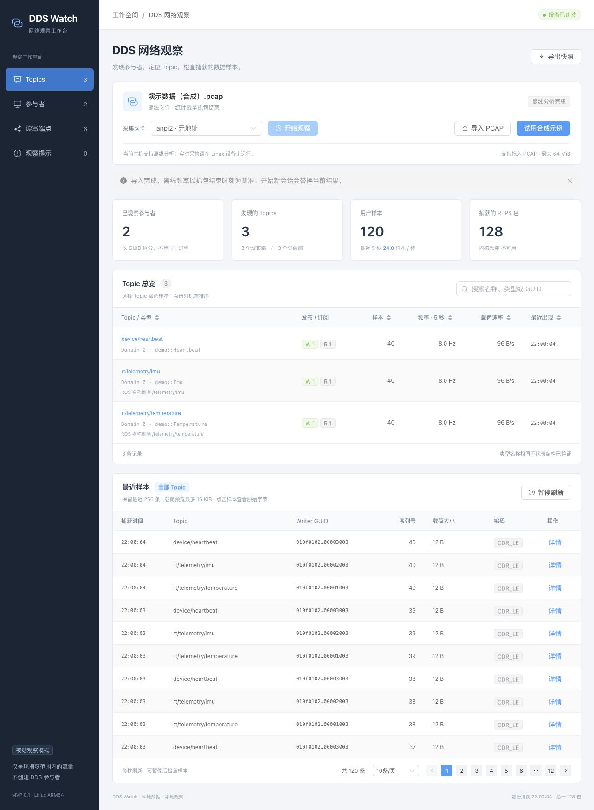
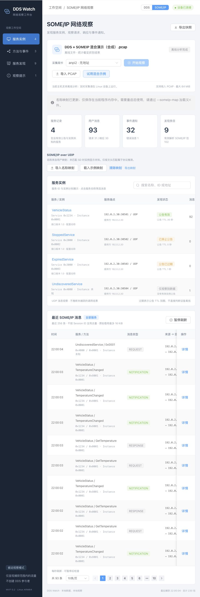

# ProtoWatch 0.2 MVP 验证记录

日期：2026 年 10 月 20 日  
开发环境：macOS ARM64，Go 1.25.5，Node.js 22.19.0  
目标产物：Linux ARM64

## 已完成检查

| 检查 | 结果 |
| --- | --- |
| Go 单元与 HTTP 集成测试 | 通过，覆盖协议长度、大小端、序列号、inline QoS、导入、实体、去重、缓存、域隔离、访问控制和导出 |
| Go race | 通过，包含并发读取快照与写入样本的测试 |
| RTPS fuzz | 10 秒配置运行通过，本轮约 456 万次输入执行，未出现崩溃 |
| Vue / TypeScript 构建 | `vue-tsc --noEmit` 与 Vite 生产构建通过，Element Plus 生产 JS 约 466 kB（gzip 约 161 kB），CSS 约 368 kB（gzip 约 50 kB） |
| 前端交互逻辑 | Vitest 6 项通过：断线恢复、旧轮询隔离、暂停与卸载清理、导入失败恢复、SOME/IP 示例 / 详情接口、名称映射请求 |
| 开发代理 | 通过 Vite 代理发送同源 POST 导入，返回 120 条样本 |
| 浏览器操作 | Element Plus 页面示例导入、菜单导航、网卡搜索、表格排序、Topic 筛选、样本翻页与页容量切换、暂停 / 恢复、详情及 Base64 切换通过 |
| 浏览器错误日志 | 最终构建未新增 error / warn；初次预览发现分页 small 参数弃用提示，已改为 size="small" |
| Linux ARM64 构建 | CGO_ENABLED=0 交叉编译通过 |
| ELF 检查 | AArch64 静态 ELF，无 PT_INTERP 或 DT_NEEDED，约 8.31 MiB |
| 自包含资源 | Vue 构建的模块脚本和样式 HTTP 测试通过；网页、示例和第三方许可文本嵌入程序，运行时不需要前端文件目录 |

前端迁移后重新执行 `make test build arm64` 和 `go test -race ./...`，均通过。RTPS fuzz 为前一轮后端验证记录，本次未修改协议解析器。

移除访问令牌后，重新执行 `make test build arm64` 通过。HTTP 测试覆盖无凭据访问、局域网 IP / 主机名 / IPv6 Host 的同源请求与跨域拒绝；本机外部地址监听启动成功。浏览器直接打开即可导入示例，页面不再显示令牌入口，控制台无错误。

合成样例的预期和实测均为 128 个包、2 个参与者、6 个端点、3 个 Topic、120 条用户样本。选中温度 Topic 后显示 40 条样本；再次处理相同流量后唯一用户样本数保持 120。该样例用于功能回归，不作为厂商兼容性证明。

组件库迁移采用 Element Plus 2.14.7 和中文语言包，构建资源、图标及运行依赖许可均内嵌。重新执行 `make test build arm64` 通过，浏览器验收使用本机 HTTP 服务与合成数据。

## SOME/IP 扩展验收（2026-10-20）

- `make test build arm64`、`go test -race ./...` 与 `go vet ./...` 通过。
- SOME/IP fuzz：5 秒、4 workers，408,077 次输入执行，无崩溃。
- 混合 PCAP：230 包，同时得到 120 条 DDS 样本与 93 条 SOME/IP 用户消息；9 条 SD 记录、4 服务、3 方法 / 事件；31 请求、30 响应、32 通知、1 错误。
- 边界覆盖：多消息、截断、SD 选项长度与引用、TTL 过期、停止公告、乱序公告、实例歧义、未知次版本、容量限制、配置失败保留旧值、并发映射与捕获。
- 浏览器：DDS / SOME/IP 切换、示例导入、名称映射的示例 / 清除 / 本地 JSON 文件导入、服务和 ID 筛选、发现 / 方法 / 提示页面、消息分页、暂停恢复、详情和 Base64 均通过；最终页面控制台无 error / warn。
- CLI：实际启动本机程序并通过 `--read` + `--someip-map` 加载混合抓包和配置，API 样本数及名称正确。
- Linux ARM64：0.2 静态 ELF 交叉构建成功，无 PT_INTERP 或动态段，8.31 MiB；SHA-256 文件已更新。

## 尚未验证

- 目标 Linux ARM64 硬件上的实际启动、AF_PACKET 抓包、capability 设置和内核丢弃计数。
- Fast DDS、Cyclone DDS 与 ROS 2 真实发布订阅环境及跨厂商兼容性。
- 真实 ECU / vsomeip / AUTOSAR 平台的 SOME/IP 互通、现场发现流量和吞吐。
- 用户设备上的吞吐、CPU、长期内存、后台高流量和 30 分钟稳定性目标。
- 真实 TLS 证书下的 HTTPS 与不同浏览器环境。

本机 Docker daemon 未运行，没有可执行目标 Linux 实时抓包的验证环境。交叉编译成功只证明目标代码能够构建，不代表上述现场验证已经通过。

## 功能边界

本次交付是 0.2 MVP（DDS MVP0 + SOME/IP TCP / UDP MVP）。SOME/IP-TP 重组、ARXML 解码仍属于后续阶段。DDS 的 IDL 解码、IP / RTPS 分片重组、PCAPNG、原始录制、完整发现生命周期和 QoS 兼容性诊断仍属后续工作，详见技术方案中的范围对照表。现有 JSON 导出只能保存内存中保留的快照和样本预览，不能作为可重放的完整抓包。

## 2026-10-20：SOME/IP 提供方筛选

- 新增有 / 无 SD 两种场景的后端回归：两个 IP 使用相同 Service ID、Instance ID、Client ID 和 Session ID，分别记录各自的请求、响应、通知，不合并提供方统计。
- `make test build arm64` 通过；最终占位文案调整后重新构建原生与 Linux ARM64 二进制，并更新 SHA-256。
- 浏览器使用双提供方合成抓包验证服务与方法列表隔离、请求归属目标服务端、消息详情、清除筛选及切换提供方清除服务子筛选；浏览器无 warning / error。
- 页面截图：[提供方筛选](someip-provider-preview.jpg)。真实硬件验证范围仍按上文说明。

## 2026-10-20：大文件流式导入

- 网页默认 4 GiB，`--max-import-mib` 可调整，CLI `--read` 不限制总大小。前端从后端读取上传上限。
- `make test build arm64`、`go test -race ./...`、`go vet ./...` 通过；前端共 8 项测试。最后的已完成文件大小展示调整通过类型检查与生产构建，原生 / ARM64 产物和 SHA-256 已更新。
- 自动回归：80 MiB 流式请求、精确大小边界、已知与未知 Content-Length 超限、包截断、未结束上传已产生数据、停止中断阻塞读取、上传超过配置的总读写时限仍可完成。前端覆盖大于 64 MiB 文件、服务端自定义上限、导入期间进度刷新和取消。
- macOS ARM64 使用 1,073,758,232 字节合成 PCAP（1,024 个 1 MiB 零填充 Ethernet 捕获记录）检查整条链路。CLI 用时约 0.67 秒，HTTP 上传约 0.88 秒，均读取全部字节、统计 1,024 包并标为 complete。两步运行在同一后端进程，`resource.getrusage(RUSAGE_CHILDREN).ru_maxrss` 显示峰值 RSS 约 15.73 MiB。该稀疏文件没有真实 DDS / SOME/IP 业务消息，仅验证大文件读取与缓冲，不代表真实协议流量、物理磁盘或 Linux ARM64 性能。
- 浏览器实际选择上述 1 GiB 文件完成上传；再次上传并取消，观察到 33 包部分结果且后台状态为 stopped。最终页面显示已读取大小、总大小和包数。
- 以 `--max-import-mib 16384` 重启后，网页显示 16 GiB 上限，控制台无 warning / error；[页面截图](large-import-preview.jpg)。

## 2026-10-20：服务端 PCAP 文件加载

- 默认启动工作目录与 `--pcap-dir`、文件目录 API、后台加载 API、CLI `--read` 后台启动已实现。浏览器只提交文件名，服务端文件不受浏览器上传大小上限约束。
- `make test build arm64`、`go test -race ./...`、`go vet ./...` 通过；前端共 10 项测试。最后的部分结果与停止状态文案调整通过类型检查和生产构建，原生 / ARM64 产物及 SHA-256 已更新。
- 自动回归覆盖目录列表、扩展名、文件大小、路径穿越 / 绝对路径 / 符号链接 / 非普通文件拒绝、损坏头部不替换旧会话、后台混合协议解析、上传上限不影响服务端文件、会话预留和停止释放。
- 浏览器直接从服务端目录加载 mixed-demo.pcap，得到 230 包、120 条 DDS 样本与 93 条 SOME/IP 消息；刷新目录可发现新文件。另用 8 GiB 稀疏合成 PCAP 验证后台启动、刷新网页后继续解析、停止后保留部分结果（停止时约 2.6 GiB / 2,628 包），不声称该文件完成了全量分析或包含真实协议流量。
- CLI `--read` 启动加载与最终内嵌网页验证通过，浏览器无 warning / error。[页面截图](server-files-preview.jpg)。目标 Linux ARM64 硬件实测范围仍按前述说明。

## SOME/IP TCP 增量验证（2026-10-20）

- `make test build arm64` 通过：TypeScript / Vite、10 项 Vitest、全部 Go 测试及两种二进制构建。
- `go test -race ./...`、`go vet ./...` 通过。TCP 流模糊测试 5 秒执行 380,357 次，通过。
- TCP 单元测试覆盖跨包头部 / 载荷、粘包、乱序与重叠、重传、序列号回绕、双向通信、SD 端点匹配、TCP / UDP 隔离、FIN / RST / 新 SYN、空闲清理、缺口、冲突、恶意长度、连接与缓存上限、magic cookie。
- 端到端导入 `tcp-demo.pcap`：86 个捕获包，4 条 TCP + 1 条 UDP 用户消息，1 条发现记录，1 个服务实例、4 个按传输区分的方法 / 事件记录。100 KiB 消息完整重组，16 KiB 预览逐字节匹配，预览截断提示符合预期。
- 在有效捕获记录边界提前结束文件，剩余 TCP 消息不入库，返回 `tcp_incomplete` 并释放缓存；先前完整消息仍保留。
- HTTP 状态、详情与导出均验证传输方式；导出保留 5 条消息，详情载荷与预期一致。
- 浏览器验证 TCP 筛选只显示 4 条、详情显示 SD 关联的提供方 / 实例、100 KiB 原始长度和 16 KiB 预览。截图：[TCP 消息详情](someip-tcp-preview.jpg)。
- Linux ARM64 产物：8,847,544 字节、静态链接 AArch64 ELF；校验文件已更新。实际 ARM64 实时网卡、真实厂商 TCP 流量及长期负载尚未验证。

连接中途捕获必须从可识别消息边界开始，缺包不自动跳过，magic cookie 暂不用于丢包后重新同步；这些边界已在 SOME/IP 文档记录。

## ProtoWatch 命名与跨平台流水线

产品、命令入口与模块名统一为 ProtoWatch / `proto-watch` / `github.com/bkcarlos/ProtoWatch`，保留仓库现有 GPL v3 LICENSE 与历史。旧截图用于功能验收记录，仍可能显示 DDS Watch 名称。

`.github/workflows/build.yml` 将前端构建结果交给 Linux amd64 / arm64、macOS amd64 / arm64、Windows amd64 五个原生平台。各平台执行依赖校验、Go vet、race 测试、无 CGO 构建、编译后二进制启动与 HTTP / PCAP 验证，最后上传压缩包及 SHA-256。流水线运行结果以 GitHub Actions 为准。

本地已验证前端 10 项 Vitest、全部 Go 测试、macOS ARM64 二进制启动、内嵌网页、服务端 PCAP 目录、TCP/UDP 示例与 JSON 导出。跨平台编译不等同目标机运行，真实抓包性能仍需现场验证。
